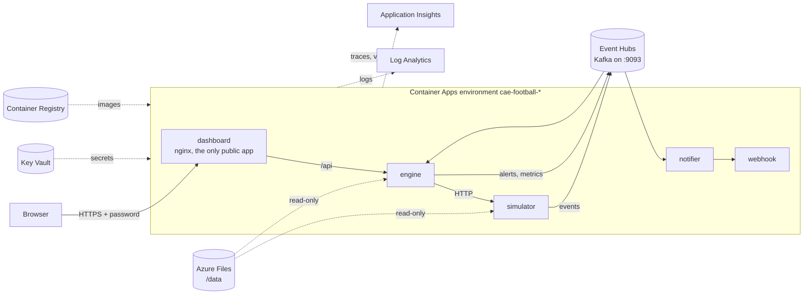

# Running it in Azure

The same stack as `make up`, on Azure Container Apps, behind a password. It's deployed by GitHub Actions and brought up only when you want it.

```sh
make cloud-up       # about 5 minutes; prints the URL
make cloud-status   # up or down, and the URL
make cloud-down     # when you're done (it also goes down every night at 03:00 Seattle time)
```

Sign in as `viewer`. The password is in your macOS Keychain (`security find-generic-password -s football-analytics-dashboard -w`) and in the repo's `DASHBOARD_PASSWORD` secret. GitHub won't show a secret again, but you can set a new one with `gh secret set DASHBOARD_PASSWORD`, then run `make cloud-up`.

## What runs where



It's the Compose stack, service for service:

| Compose | Azure | Notes |
| --- | --- | --- |
| `redpanda` + `topics` | Event Hubs, Standard | Same Kafka protocol. The three topics are event hubs, created by Bicep. |
| `simulator`, `engine`, `notifier` | Container Apps | Same images, one replica each. The engine's state is in memory, so it never scales out. |
| `dashboard` | Container App | Same nginx image. It's the only app reachable from the internet, and it asks for the password. |
| `webhook` | Container App | Prints the alerts in its logs. It's used only when `ALERT_WEBHOOKS` isn't set (see below). |
| `markets` | Container App | Reads the venues' public APIs; internal ingress, reached through the dashboard's `/api/markets`. |
| `aspire` | Application Insights | Where traces go. |
| `./data` mounted | Azure Files share `data`, mounted at `/data` | Read-only. |

The apps find each other by name inside the environment, as in Compose: the dashboard proxies to `http://engine`, and the engine calls `http://simulator`. Only the dashboard has public ingress. The engine and simulator have internal ingress only (reachable from the other apps), and the notifier has none. So the API and the broadcast controls can only be reached through the dashboard, behind its password.

## The two stages

`infra/main.bicep` deploys in two stages. The split keeps it cheap without losing anything slow to recreate.

**Base**, always there (about $5 a month, nearly all of it the registry):

| Resource | Name | Why it stays |
| --- | --- | --- |
| Container Registry, Basic | `crfootball<suffix>` | It holds the images, so a new `up` only pushes what changed. |
| Key Vault | `kv-football-<suffix>` | It holds the secrets. |
| Storage account and file share | `stfootball<suffix>` / `data` | The data, about 190 MB, is uploaded once. |
| Log Analytics and Application Insights | `log-…`, `appi-…` | The logs and traces outlive the apps (30 days), so you can look back after `down`. |
| Container Apps environment | `cae-football-<suffix>` | It's free with nothing running, and it takes about 15 minutes to create (the rest of an `up` takes about 4). Keeping it also keeps the URL the same. |

**Apps**, only while up (about $0.15 an hour):

| Resource | Cost | |
| --- | --- | --- |
| Event Hubs namespace, Standard, 1 throughput unit | ~$0.03/hour | Basic has no Kafka endpoint. |
| engine (0.5 vCPU, 1 GiB) and four apps (0.25 vCPU, 0.5 GiB each) | ~$0.11/hour | Consumption plan, billed per second. The monthly free grant covers the first ~50 hours. |

`<suffix>` is six characters derived from the resource group, the same on every deploy. Registry, vault, storage and Event Hubs names must be unique across Azure, hence the suffix.

## Deploying: `.github/workflows/deploy.yml`

`make cloud-up` runs the workflow on `main` (`gh workflow run`) and follows it. It:

1. **Signs in with OIDC.** GitHub gives the job a short-lived token, and Azure trusts it for this repo's `main` branch only. That trust is the federated credential the bootstrap made, so no Azure password or key is stored in GitHub.
2. **Deploys the base.** If nothing changed, Azure has nothing to do.
3. **Builds and pushes the five images**, tagged with the commit, using the same Docker layer cache as CI (`infra/images.hcl`).
4. **Uploads the data** to the share: `make fetch-data`, cached between runs. A fingerprint file on the share skips the upload when nothing changed.
5. **Deploys the apps** (`deployApps=true`, the image tag, and the secrets in a parameters file so they never appear on a command line).
6. **Runs the smoke test** against the public URL (`scripts/smoke_test.py --external`, signing in with the password). It plays the 2022 final at 1000×, checks the result and the rewatch, and fails the run if they're wrong.

`make cloud-down` deletes the container apps and the Event Hubs namespace, which are everything that costs by the hour. The same job runs every night on a schedule, so a forgotten `up` costs at most a day.

The deploy's identity is only a **Contributor** on the resource group: it can create and delete resources, but not grant access. Granting access needs Owner, so `infra/bootstrap/bootstrap.sh` does it once, on your machine. It creates the apps' managed identity and lets it pull images (AcrPull) and read secrets (Key Vault Secrets User).

## Secrets

| Secret | Where it comes from | Who reads it |
| --- | --- | --- |
| The dashboard's password | GitHub secret `DASHBOARD_PASSWORD` → Key Vault `dashboard-password` | the dashboard, as `DASHBOARD_PASSWORD` |
| Event Hubs connection string | created by Bicep → Key Vault `eventhubs-connection-string` | simulator, engine, notifier, as `KAFKA_SASL_PASSWORD` |
| Alert webhooks (optional) | GitHub secret `ALERT_WEBHOOKS`, comma-separated URLs → Key Vault `alert-webhooks` | the notifier, as `NOTIFIER_WEBHOOKS` |

The apps read secrets through their managed identity when they start, so no secret is ever in an app's configuration or the deployment history.

With no `ALERT_WEBHOOKS` set, alerts go to the stand-in `webhook` app, which prints them to its log. To get them in Slack or Teams, set the secret to an incoming-webhook URL (`gh secret set ALERT_WEBHOOKS`) and run `make cloud-up` again.

The password works by HTTP basic auth in nginx (`dashboard/19-basic-auth.envsh`): every request asks for `viewer` and the password, except `/healthz`, which the platform's probes use. Browsers remember it for the tab, including for the event stream. The connection is HTTPS, so the password is encrypted in transit. To revoke someone's access, set a new password.

## Logs and traces

**Logs.** Every app writes JSON lines to stdout, collected in Log Analytics. In the portal, open the workspace `log-football-*` and go to **Logs**. Or use the CLI:

```sh
az containerapp logs show -g rg-football-analytics -n engine --follow   # live
```

```kusto
// The last hour's warnings and errors, all apps
ContainerAppConsoleLogs_CL
| where TimeGenerated > ago(1h)
| extend line = parse_json(Log_s)
| where tostring(line.level) in ("WARN", "WARNING", "ERROR")
| project TimeGenerated, ContainerAppName_s, msg = tostring(line.msg), line
```

**Traces.** The environment runs a managed OpenTelemetry agent and injects `OTEL_EXPORTER_OTLP_ENDPOINT` into every app. That turns the apps' tracing on (it's off without it), and the agent forwards the spans to Application Insights. In the portal, open `appi-football-*`:

- **Application map:** simulator → engine → notifier, with the calls between them.
- **Transaction search**, filtered to an `alert …` span: one alert's whole journey, from the simulator sending the event to the webhook POST (see [Logs and traces](../README.md#logs-and-traces)).

A log line written inside a span carries its `trace_id`, so the two can be joined.

## First-time setup (done)

1. `infra/bootstrap/bootstrap.sh`, run once by an Owner. It created the resource group and the $50 budget alert, the deploy's OIDC identity, and the apps' managed identity and its roles.
2. `gh secret set DASHBOARD_PASSWORD` (12+ characters).
3. `make cloud-up`.

## Costs, checked

- **Budget:** the $50/month budget emails at 50%, 80% and 100% of actual spend, and at 100% of forecast.
- **Log cap:** Log Analytics stops ingesting at 0.5 GB a day, so a noisy bug can't run up the bill.
- **Current spend:** **Cost Management** in the portal, filtered to `rg-football-analytics`, or `az consumption usage list`.
