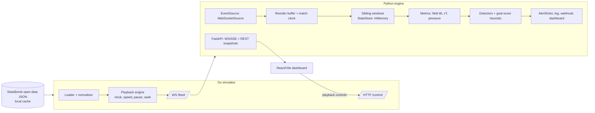

# Project Plan & Roadmap

This is the implementation roadmap for the Live Football Analytics Stream. The product vision is in [`copilot_context.md`](copilot_context.md), and the decisions taken so far are recorded in its **Decisions** section.

## Goals
- **Portfolio piece** that shows streaming, data engineering and cloud skills.
- **Personal tool** for watching match replays with live analytics.
- **Product prototype** that could later take a real live data feed.
- **Learning Go**, alongside Python and TypeScript.

## Approach
A phased build in three languages:

- **Go stream simulator** replays StatsBomb open data as a live WebSocket feed, with pause, resume, speed and seek.
- **Python analytics engine** computes rolling-window metrics and heuristic alerts.
- **React + Vite dashboard** shows metrics and alerts live.

The engine works through three interfaces: `EventSource`, `StateStore` and `AlertSink`. Because the code only depends on these, a broker (Phase 2), trained models (Phase 3) and cloud deployment (Phase 4) can be added later without rewrites.

## Architecture (Phase 1)



### Repository layout

```
schema/        jsonschema/ (single source of truth for events, controls, metrics, alerts) + fixtures/{valid,invalid}/
simulator/     Go module: cmd/simulator, internal/{loader,playback,clock,server}
engine/        Python package (uv): sources/, clock/, windows/, metrics/, detectors/, sinks/, api/
dashboard/     React + Vite + TypeScript
data/          gitignored local cache of StatsBomb files (fetched by script)
scripts/       data fetch, xT grid computation, backtests
infra/         Bicep modules + parameter files (Phase 4)
docs/          this plan, architecture notes, metric definitions
Makefile       gen, dev, test, lint, run-all targets
.github/workflows/ci.yml
```

## Key design rules
- **Match time, not wall-clock.** Windows, metrics and alerts are based on match time (period + game clock), so results are identical at any playback speed and after a seek.
- **Canonical event schema.** The simulator converts StatsBomb events into a slim format: `id`, `match_id`, `offset`, `period`, `match_clock_s`, `type`, `team`, `player`, `location`, `end_location`, `outcome`, `possession_id`, plus `schema_version`. The JSON Schemas in `schema/jsonschema/` are the single source of truth.
  - Types are generated for each language:
    - Python: pydantic, via `datamodel-code-generator`
    - TypeScript: via `json-schema-to-typescript`
    - Go: via `go-jsonschema` (generated `UnmarshalJSON` also enforces the schema constraints)
  - Generated code is committed, and CI fails if `make gen` would change it.
  - Shared example messages in `schema/fixtures/` (valid and invalid) are checked by the tests in all three languages.
  - Raw StatsBomb JSON never leaves the simulator, which keeps the boundary clean for a future live provider.
- **Events behave like a broker log.**
  - Every event has a stable `id` and a per-match sequence `offset`.
  - `EventSource` has one method, `subscribe(from_offset)`. Seeks need no method of their own: the feed sends a `reset` marker and replays from offset 0.
  - Processing is safe to repeat: duplicates are dropped by `id`.
  - Everything is keyed by `match_id`, which becomes the broker partition key later.
  - The WebSocket feed sends one JSON event per message, and clients resume after a disconnect with `?from_offset=N`.
- **Out-of-order safety.** The engine holds events in a small reorder buffer with a watermark, which sets how late (in match seconds) an event may arrive and still be accepted (`--allowed-lateness`, default 5s). Events behind the watermark are dropped and counted, not patched in. The simulator's `--jitter` mode shuffles events slightly to test this.
- **Windows run on play time.** Periods are joined end to end (each starts where the previous one's last event was), so a 5-minute window runs smoothly across half-time. `--window-mode per_period` restarts windows at each kick-off instead. Penalty shootout events are left out of windows.
- **Seek semantics.**
  1. When playback seeks, the simulator sends a `reset` control message.
  2. The engine discards its window state.
  3. It then rebuilds that state by fast-replaying from offset 0 up to the target time.
- **Catch-up is a replay too.** Each `match_start` carries the feed's `head`, the number of events already published. When the engine connects or reconnects mid-match, it rebuilds state from those events without alerting on them.
- **One match at a time in v1.** All state, topics and APIs are still keyed by `match_id`, so several matches can be supported later.
- **No database in v1.** Alerts go to the log and, with `--webhook URL`, are POSTed as JSON. Storage is added only when there's a need.
- **Sinks never hold up the match.** An `AlertSink` takes each alert without blocking. The webhook sink queues alerts for a background worker, which retries network failures, server errors and 429s with exponential backoff; other 4xx errors are not retried. A full queue drops the alert with a warning.
- **Attribution and licensing.**
  - StatsBomb data is never committed, and their open data terms (including attribution) are followed.
  - The xT grid source is credited.

## Metric definitions (v1)
Every metric is a pure function of the events in a window, recomputed on demand rather than updated event by event. That keeps them easy to test on hand-built sequences, and identical after a seek. Locations are on StatsBomb's 120×80 pitch, with each event oriented so the acting team attacks towards x=120.

- **Field tilt (per window):** each team's share of attacking-third (x ≥ 80) touches in the window. Touches are passes, carries, successful receptions and shots. With no touches, both teams get 50%.
- **xT added:** for each completed pass or carry (outcome not failed, both locations known), `xT(end_cell) − xT(start_cell)` on a 12×8 grid, summed per team per window. **xT velocity** is xT added per minute of play actually covered by the window, with a floor of 1 minute, so a window that is still filling up early in a match is not under-reported.
  - The grid is Karun Singh's published one. It has no licence, so `make fetch-data` downloads it to `data/xt/` and it is never committed. In Phase 3 we compute our own and compare.
- **Sustained pressure index:** a weighted sum of five counts (default weights in brackets):
  - recoveries (successful ball recoveries and interceptions) in the attacking half (1.0);
  - box entries: completed passes or carries from outside the opponent's box into it (1.5);
  - shot value: 1 + xG per shot (2.0);
  - sustained actions: own on-ball actions in own possession, in runs of 3 or more inside the final third; a possession change or an action outside the final third ends the run (0.25 per action);
  - box actions: own on-ball actions in the opponent's box, from the 2nd onwards in each possession (0.5).

  The weights are a `PressureWeights` config. They are not tuned yet (Phase 3).
- **Windows:** rolling 5 and 10 minutes of play. The whole-match baseline (an exponentially weighted mean and variance) belongs to the detectors, which are its only users.

## Predictive signals (v1, rule-based)
Detectors run on a fixed tick of play time: once every 30 seconds, on the first released event past each multiple of 30s. Penalty shootouts have no ticks. All windows below are 5 minutes of play, and the thresholds are untuned (Phase 3).

- **Momentum shift (`momentum_shift`):** a team's 5' pressure index against its own match baseline, an exponentially weighted mean and variance over play time (half-life 10 minutes). It fires when `z = (pressure − mean) / max(std, 3)` reaches 2.0. The z-score uses the baseline before the current value is added. There are no alerts in the first 15 minutes of play, while the baseline warms up.
- **Goal threat (`goal_threat`):** `sigmoid(−3 + 1.5 · pressure / 18 + 1.5 · xT velocity / 0.05)`, firing at 0.5. The scales are about the top few percent of 5' values in the 2022 final, so a team at both scores exactly 0.5. Only play since the last goal in the window counts, because a goal resets the danger. Shots count through the pressure index. It is a *heuristic score*, not a probability, until it is calibrated in Phase 3.
- **Control shift (`control_shift`):** a team's pressure balance `(own − opponent) / (own + opponent + 5)`, from −1 to 1. The `+5` keeps a quiet spell from looking like total control. It fires when the balance goes from ≤ −0.2 over the previous 5 minutes to ≥ 0.5 over the last 5, so the team that was pinned back is now on top. It needs 10 minutes of play.
- **Cooldown:** after an alert, the same detector stays quiet for the same team for 5 minutes of play.
- **Replays are silent.** After a seek or a mid-match connect, detectors still run on the replayed events and cooldowns still apply, but no alerts come out. The alerts after a seek are exactly those that would have come out live, with the same ids (`{match_id}-{type}-{team_id}-{offset}`).
- **Alert payload:** each alert carries `type`, `team_id`, the match time and offset, `value` and `threshold`, the window, the contributing `features`, and a readable `message`.

## Roadmap

### Phase 0: Foundations
- [x] Monorepo scaffold:
  - Go modules
  - uv + ruff + pytest + mypy
  - pnpm + Vite + oxlint + vitest
  - Makefile
  - `.gitignore` (including `data/`)
- [x] JSON Schemas + fixtures for events, controls, metrics and alerts; `make gen` generates Go, Python and TS types.
- [x] Data fetch script for the 2022 FIFA World Cup (StatsBomb open data).
- [x] CI that runs:
  - lint and tests for Go, Python and TS
  - fixture contract tests
  - a check that generated code is up to date

### Azure bootstrap (free, can run alongside Phase 0)
Scripted in `infra/bootstrap/` (`bootstrap.sh`, run once locally by a subscription Owner; safe to re-run).
- [x] Install the Azure CLI and sign in (Visual Studio subscription; spending limit on).
- [x] Create resource group `rg-football-analytics` in `westus2`.
- [x] $50/month budget on the resource group, emailing at 50/80/100% actual and 100% forecast.
- [x] Connect GitHub Actions to Azure via OIDC (federated credential for `main` using GitHub's immutable ID-based subject, Contributor on the resource group only, no stored secrets; repo variables `AZURE_CLIENT_ID`/`AZURE_TENANT_ID`/`AZURE_SUBSCRIPTION_ID`).
- [x] Verify with the manual **Azure login check** workflow on `main`.

### Phase 1: MVP (one match replayed end to end, with live dashboard)
- [x] **Go simulator:**
  - loader and normalizer
  - playback: pause, resume, speed, seek
  - match clock: halves, stoppage time, extra time
  - WebSocket feed with offset-based resume
  - HTTP control API
  - `--jitter` mode
- [x] **Engine core:**
  - `WebSocketSource`
  - reorder buffer and watermark
  - match-clock tracker
  - in-memory sliding-window `StateStore`
  - seek and reset handling
- [x] **Metrics:** field tilt, xT (published grid) and pressure index, unit-tested on hand-built event sequences.
- [x] **Detectors and alert routing:**
  - momentum z-score
  - goal-score heuristic
  - next-to-control indicator
  - cooldowns
  - log and webhook sinks
- [ ] **Engine API (FastAPI):**
  - dashboard alert sink
  - WS/SSE streams for metrics and alerts
  - REST endpoints for snapshots and the match list
  - passthrough of playback controls to the simulator
- [ ] **Dashboard (lean):**
  - match picker
  - playback controls
  - live charts: field tilt, xT, pressure
  - alert feed
  - *The pitch view comes after the MVP.*
- [ ] **End-to-end smoke test:** replay the 2022 World Cup final (Argentina vs France) at high speed and check the key metrics and alerts. For example, France's comeback should trigger a control-shift alert for France at about 82'.

### Phase 2: Containers and broker
- [ ] Dockerfiles for all three services, plus Docker Compose.
- [ ] Redpanda-based `EventSource` and publisher:
  - uses a standard Kafka client with no Redpanda-only features, so it also works with Azure Event Hubs
  - topics keyed by `match_id`
  - seek works by rewinding the consumer offset
- [ ] Publish metrics and alerts to the broker so several services can consume them.
- [ ] CI builds the container images.
- [ ] *(Only if justified)* Redis `StateStore`, for running several engine instances or recovering after a crash.

### Phase 3: Modeling
- [ ] Compute our own xT grid from StatsBomb data and compare it with the published grid.
- [ ] Backtest harness that runs many matches offline through the engine.
- [ ] Training data: windows labelled by whether a goal follows within X minutes.
- [ ] Train logistic regression or gradient-boosted (GBM) models; evaluate with Brier score and calibration plots.
- [ ] Swap the trained model in behind the existing detector interface, and tune heuristic thresholds against the data.
- [ ] *(Optional)* A Streamlit app for exploring backtest results.

### Phase 4: Azure deployment & operations
- [ ] Bicep modules in `infra/`:
  - Container Registry (Basic)
  - Log Analytics + Application Insights
  - Key Vault
  - Container Apps: an environment plus the simulator and engine apps. The engine runs at least 1 replica, since its state is in memory, and both use WebSocket ingress.
  - Static Web Apps for the dashboard
  - Event Hubs Standard, using its Kafka endpoint
- [ ] Dashboard access control: shared password or built-in Microsoft account sign-in. Playback controls are never public.
- [ ] GitHub Actions deploy pipeline (signs in via OIDC):
  1. build the images
  2. push them to the Container Registry
  3. run `az deployment group create`
- [ ] Structured logging and OpenTelemetry tracing.
- [ ] Teardown and recreate scripts for the costly resources, to save credit. Check costs in the Azure pricing calculator first.

### Phase 5 (optional): Live provider
- [ ] Evaluate paid live feeds for how detailed their coordinates are.
- [ ] Implement `LiveProviderSource` behind the same schema.

## Open questions
- Azure region.
- Shared password or Microsoft sign-in for the dashboard (Phase 4).
- The detector windows (5 minutes in v1) and the alert thresholds; tune in Phase 3.
- Whether generated code is committed or generated in CI.
- Whether a more compact wire format is worth it on the broker (unlikely at this scale).

## Known gaps
- **Own goals are not in the schema yet.** StatsBomb's "Own Goal For" and "Own Goal Against" events normalize to `other`, so a score built only from goal shots misses own goals. The 2022 final has none. Fix it before replaying other matches or showing a live score: add an event type and run `make gen`.
- **Runs and possessions are cut at the window edge.** A final-third run or a box possession that started before the window only counts its in-window actions, so the pressure index slightly under-counts at the edge. This is acceptable for a rolling signal.
- **Alerts can be lost.** The webhook sink drops an alert when its queue is full or after its retries fail, and gives up on anything still queued 5 seconds after the engine stops. That is fine for notifications; the broker (Phase 2) gives durable delivery.
- **Pressure weights are untuned.** On the 2022 final, sustained actions make up about half of the index. Revisit in Phase 3 together with the alert thresholds.
